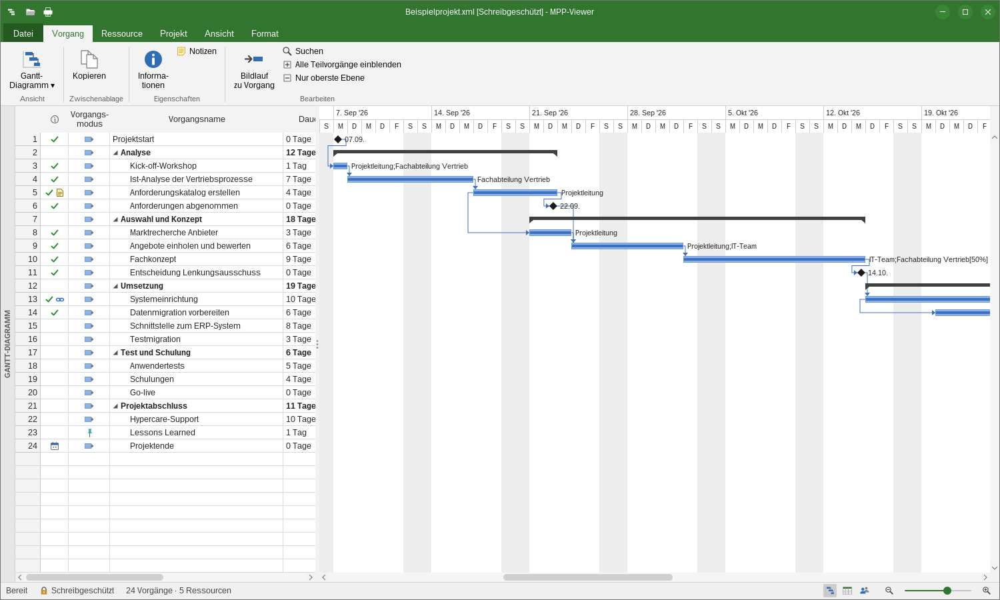
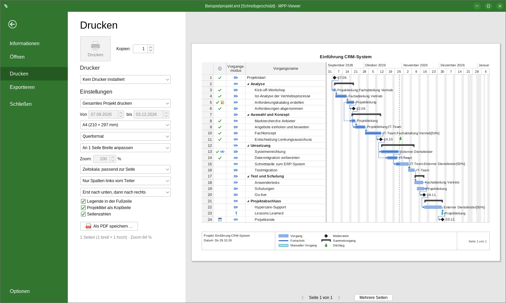
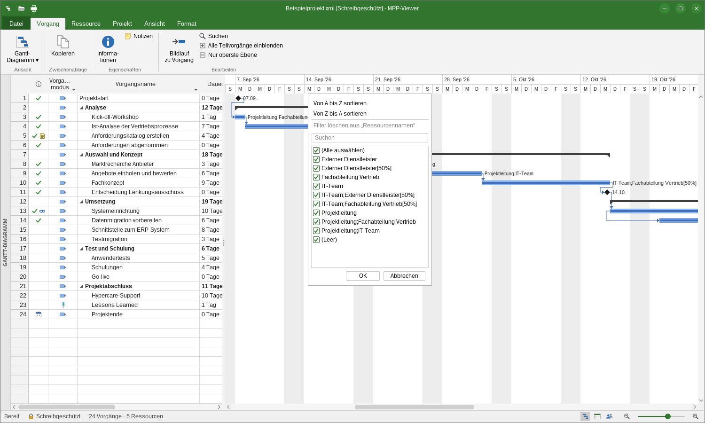

# MPP-Viewer

**English** · [Deutsch](README.de.md)

[](https://github.com/TripleTheP/mpp-viewer/actions/workflows/build.yml)
[](https://github.com/TripleTheP/mpp-viewer/actions/workflows/codeql.yml)
[](https://github.com/TripleTheP/mpp-viewer/releases/latest)
[](LICENSE)

A portable, read-only viewer for Microsoft Project files (`.mpp`) with printing and export to PDF, Excel, PNG and
CSV. The user interface follows Microsoft Project (ribbon, Gantt chart, sheets, print preview), so anyone familiar
with Project can use it right away. No Microsoft Project license, installation or administrator rights are
required.



<sub>Screenshots show the German user interface; English is available under File → Options.</sub>

## Features

### Viewing

- Views: Gantt Chart, Tracking Gantt, Task Sheet and Resource Sheet
- Uses the table definitions stored in the file: columns, custom column titles, order and widths
- Applies the saved sort order, filters, AutoFilter settings and cell formatting (background and text color,
  bold, italic, underline) from the file
- Collapsible summary tasks, outline levels, milestones, baselines, progress, critical path, deadlines, split
  tasks, dependency arrows (FS/SS/FF/SF), non-working time and a today line
- Indicators for notes, constraints, completed tasks and hyperlinks, with tooltips
- Zooming with Ctrl+mouse wheel or a zoom slider, plus Entire Project, Selected Tasks and Scroll to Task
- Column AutoFilter menus for sorting and filtering
- Read-only Task Information, Resource Information, Project Information and Statistics dialogs
- Search (Ctrl+F) and copy of selected rows to Excel (Ctrl+C)
- German or English user interface, with date and duration formats matching Microsoft Project

### Printing



- Office-style print preview with printer, copies, paper size and orientation
- Fit to 1, 2 or 3 pages wide, fit everything on one page, or a fixed zoom level
- Timescale fitted to the page automatically, taken from the view, or set to days, weeks, months or quarters
- Entire project or a date range, columns left of the divider or all columns
- Footer with legend, project name, date and page numbers

### Export

- **PDF**: paginated like the print preview or as a single large page, with vector graphics and searchable text
- **Excel (.xlsx)**: tasks, resources and project properties, with outline grouping, real date values, a frozen
  header row and AutoFilter
- **PNG**: the complete view as an image at 100 % or 200 %
- **CSV**: UTF-8, semicolon-separated (German) or comma-separated (English), opens directly in Excel



### Supported files

`.mpp` (Project 98 to Project 2021 and Microsoft 365), `.mpt`, `.mpx`, Project XML and other formats supported by
[MPXJ](https://www.mpxj.org), for example Primavera XER/PMXML, Asta Powerproject and GanttProject.
Password-protected files are not supported.

<a id="download-und-start-windows"></a>

## Download and installation (Windows)

1. Download `MPP-Viewer-<version>-windows-x64-portable.zip` from the
   [latest release](https://github.com/TripleTheP/mpp-viewer/releases/latest).
2. Extract the archive to any location, for example `C:\Tools`, a USB drive or a network share.
3. Run `MPP-Viewer\MPP-Viewer.exe`.

The package includes its own Java runtime. No installation, administrator rights or separately installed Java are
needed. Project files can be opened with drag and drop or with **Open with → MPP-Viewer.exe** in File Explorer.
A sample project (`Beispielprojekt.xml`) is included in the program folder.

Settings (language, window size, recently used files) are stored per user in `%APPDATA%\MPP-Viewer`. To keep
them in the program folder instead, create an empty file named `portable.properties` next to `MPP-Viewer.exe`.

**Code signing:** Windows releases are code-signed through the SignPath Foundation. Free code signing provided by
[SignPath.io](https://about.signpath.io), certificate by [SignPath Foundation](https://signpath.org). See the
[code signing policy](#code-signing-policy). Signing is currently being set up. Until signed releases are
available, downloads can be verified with the published checksums and build attestations
(see [Verifying downloads](#verifying-downloads)).

## Command-line export

Files can be exported without opening a window, for example from scripts or scheduled tasks:

```bat
MPP-Viewer.exe --export "\\server\projects\Plan.mpp" "C:\Reports\Plan.pdf"
```

The output format is determined by the file extension: `.pdf` (paginated like the print preview), `.xlsx`, `.csv`
or `.png`. The exit code is `0` on success.

## Keyboard shortcuts

| Shortcut | Action |
| --- | --- |
| Ctrl+O | Open file |
| Ctrl+P | Print preview |
| F12 | Export |
| Ctrl+F | Find |
| Ctrl+C | Copy selected rows |
| Ctrl+mouse wheel, Ctrl+Plus/Minus | Zoom the timescale |
| Shift+mouse wheel | Scroll the chart horizontally |
| Ctrl+Shift+F5 | Scroll to task |
| Alt+Shift+Minus/Plus | Collapse/expand subtasks |
| Double-click, Enter | Task Information |
| Ctrl+W | Close file |
| Esc | Leave the File (backstage) view |

## Security and enterprise deployment

- No installation, no administrator rights and no registry changes
- **No network connections**: no update checks, no telemetry and no online content
- Project files are only read and never modified
- Every release includes SHA-256 checksums, GitHub build provenance attestations and a CycloneDX software bill of
  materials (SBOM)
- Source code is analyzed with CodeQL, and dependencies are monitored by Dependabot

[SECURITY.md](SECURITY.md) describes file system access, AppLocker/WDAC rules and how to report vulnerabilities.

### Verifying downloads

```powershell
# Compare with SHA256SUMS.txt from the release
Get-FileHash .\MPP-Viewer-<version>-windows-x64-portable.zip -Algorithm SHA256

# Verify that the file was built by GitHub Actions from this repository (requires GitHub CLI)
gh attestation verify .\MPP-Viewer-<version>-windows-x64-portable.zip --repo TripleTheP/mpp-viewer

# Check the digital signature (signed releases)
Get-AuthenticodeSignature .\MPP-Viewer\MPP-Viewer.exe
```

## Code signing policy

Free code signing provided by [SignPath.io](https://about.signpath.io), certificate by
[SignPath Foundation](https://signpath.org).

- Only `MPP-Viewer.exe` is signed. It is built by GitHub Actions on GitHub-hosted runners from the public source
  code in this repository.
- Every signing request is approved manually by an approver.
- Bundled third-party components (the Eclipse Temurin Java runtime, Java libraries and the FlatLaf native library)
  are shipped unmodified and are not signed with the project certificate.

| Role | Members |
| --- | --- |
| Committers and reviewers | [TripleTheP](https://github.com/TripleTheP) |
| Approvers | [TripleTheP](https://github.com/TripleTheP) |

**Privacy policy:** This program will not transfer any information to other networked systems unless specifically
requested by the user or the person installing or operating it.

## Building from source

Requirements: JDK 25 and Maven 3.9.

```bash
mvn package                       # build and run tests; output in target/dist
java -jar target/dist/mpp-viewer.jar
bash packaging/build-portable.sh  # portable package with a bundled Java runtime (on Windows: Git Bash)
```

GitHub Actions builds and tests every push on Linux and Windows. When the version in `pom.xml` changes on `main`, a
release with the portable Windows package is created automatically.

### Project structure

| Package | Contents |
| --- | --- |
| `core` | File loading (MPXJ), columns, outline, sorting and filtering, Project-style formatting |
| `render` | Drawing of sheets, timescale and Gantt chart, shared by screen, print and export |
| `print` | Pagination, printing and print preview |
| `export` | PDF, PNG, Excel (built-in lightweight XLSX writer) and CSV |
| `ui` | Main window, ribbon, backstage view and dialogs |
| `i18n` | German and English texts |

## Contributing

Bug reports and suggestions are welcome as [GitHub issues](https://github.com/TripleTheP/mpp-viewer/issues). Please
report security vulnerabilities privately as described in [SECURITY.md](SECURITY.md).

## License

MPP-Viewer is released under the [MIT license](LICENSE). Third-party components and their licenses are listed in
[THIRD-PARTY-NOTICES.md](THIRD-PARTY-NOTICES.md).

Microsoft and Microsoft Project are trademarks of the Microsoft group of companies. This project is not affiliated
with, endorsed by or sponsored by Microsoft.
